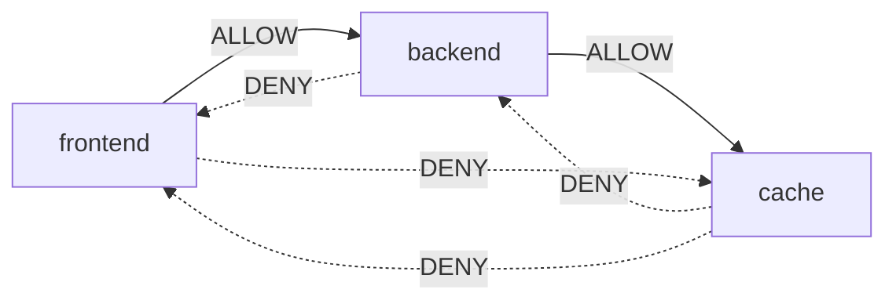
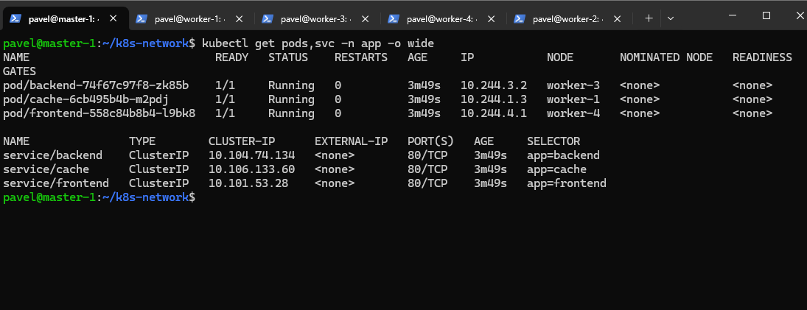
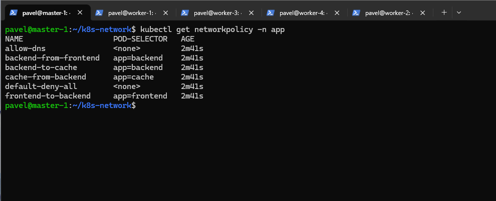
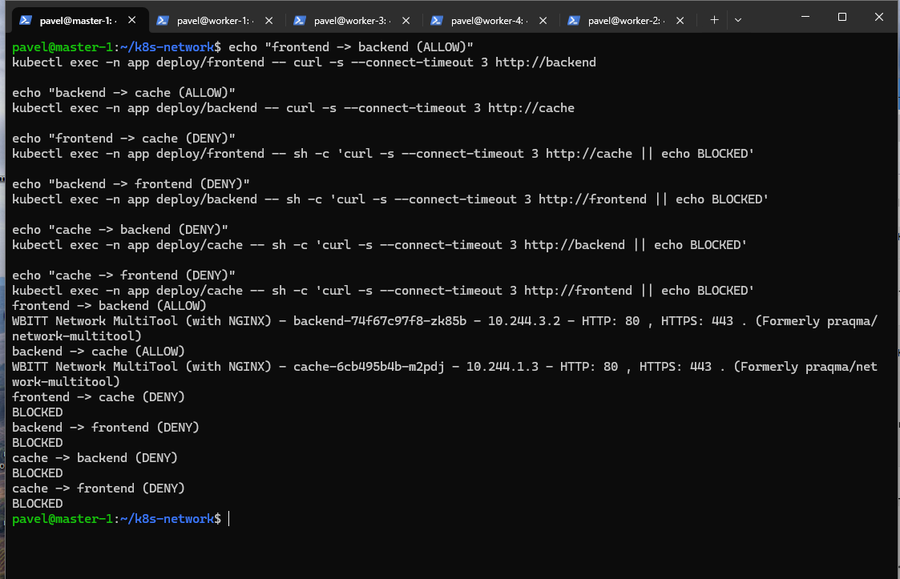

# Домашнее задание к занятию «Как работает сеть в K8s»

## Цель

Настроить сетевую политику доступа между Pod'ами Kubernetes.

Необходимо разрешить только следующую цепочку:

```text
frontend → backend → cache
```

Все остальные подключения между этими приложениями должны быть запрещены.

---

## Используемый кластер

Для выполнения задания использовался Kubernetes-кластер:

- 1 Control Plane;
- 4 Worker-ноды;
- Kubernetes `v1.37.2`;
- Container Runtime — `containerd`;
- сетевой плагин — `Calico`.

Перед выполнением задания кластер был переведён с Flannel на Calico.

После миграции все 5 нод находились в состоянии `Ready`, а `calico-node` был запущен на каждой ноде.

---

## Схема взаимодействия



Разрешено:

```text
frontend → backend
backend → cache
```

Запрещено:

```text
frontend → cache
backend → frontend
cache → backend
cache → frontend
```

---

# 1. Создание приложений

Для приложений создан namespace:

```text
app
```

В задании указан namespace `App`, но имена namespace в Kubernetes используются в нижнем регистре, поэтому был создан namespace `app`.

В namespace созданы три Deployment:

- `frontend`;
- `backend`;
- `cache`.

Для всех приложений используется образ:

```text
wbitt/network-multitool
```

Для каждого приложения также создан отдельный Service типа `ClusterIP`.

Манифест находится в файле:

```text
apps.yaml
```

Применение:

```bash
kubectl apply -f apps.yaml
```

Проверка:

```bash
kubectl get pods,svc -n app -o wide
```

В результате все три Pod находятся в состоянии `Running`.

Также для каждого приложения создан Service:

- `frontend`;
- `backend`;
- `cache`.



---

# 2. Создание NetworkPolicy

Для ограничения сетевого доступа создан файл:

```text
network-policy.yaml
```

Политики применены командой:

```bash
kubectl apply -f network-policy.yaml
```

Проверка:

```bash
kubectl get networkpolicy -n app
```

Было создано 6 политик:

```text
allow-dns
backend-from-frontend
backend-to-cache
cache-from-backend
default-deny-all
frontend-to-backend
```



---

## default-deny-all

Политика запрещает весь входящий и исходящий трафик для Pod'ов namespace `app` по умолчанию.

После этого необходимый трафик разрешается отдельными NetworkPolicy.

---

## allow-dns

Разрешает приложениям обращаться к DNS Kubernetes.

Это необходимо, чтобы Pod'ы могли использовать имена Service:

```text
frontend
backend
cache
```

---

## frontend-to-backend

Разрешает исходящий HTTP-трафик:

```text
frontend → backend
```

на порт `80`.

---

## backend-from-frontend

Разрешает Pod'у `backend` принимать соединения от `frontend`.

---

## backend-to-cache

Разрешает:

```text
backend → cache
```

на порт `80`.

---

## cache-from-backend

Разрешает Pod'у `cache` принимать соединения от `backend`.

---

# 3. Проверка разрешённого трафика

## frontend → backend

Команда:

```bash
kubectl exec -n app deploy/frontend -- \
curl -s --connect-timeout 3 http://backend
```

Результат:

```text
frontend -> backend (ALLOW)
WBITT Network MultiTool (with NGINX) - backend...
```

Соединение разрешено.

---

## backend → cache

Команда:

```bash
kubectl exec -n app deploy/backend -- \
curl -s --connect-timeout 3 http://cache
```

Результат:

```text
backend -> cache (ALLOW)
WBITT Network MultiTool (with NGINX) - cache...
```

Соединение разрешено.

---

# 4. Проверка запрещённого трафика

## frontend → cache

```bash
kubectl exec -n app deploy/frontend -- \
sh -c 'curl -s --connect-timeout 3 http://cache || echo BLOCKED'
```

Результат:

```text
BLOCKED
```

---

## backend → frontend

```bash
kubectl exec -n app deploy/backend -- \
sh -c 'curl -s --connect-timeout 3 http://frontend || echo BLOCKED'
```

Результат:

```text
BLOCKED
```

---

## cache → backend

```bash
kubectl exec -n app deploy/cache -- \
sh -c 'curl -s --connect-timeout 3 http://backend || echo BLOCKED'
```

Результат:

```text
BLOCKED
```

---

## cache → frontend

```bash
kubectl exec -n app deploy/cache -- \
sh -c 'curl -s --connect-timeout 3 http://frontend || echo BLOCKED'
```

Результат:

```text
BLOCKED
```

Полная проверка разрешённых и запрещённых соединений:



---

# Итог

В результате была настроена следующая схема сетевого доступа:

```text
frontend ───────→ backend ───────→ cache
          ALLOW           ALLOW
```

Другие соединения между приложениями запрещены:

```text
frontend ──X──→ cache
backend  ──X──→ frontend
cache    ──X──→ backend
cache    ──X──→ frontend
```

Таким образом:

- созданы приложения `frontend`, `backend` и `cache`;
- приложения размещены в namespace `app`;
- используется образ `network-multitool`;
- для каждого приложения создан Service;
- в качестве CNI используется Calico;
- весь трафик по умолчанию запрещён;
- разрешена только цепочка `frontend → backend → cache`;
- разрешённые соединения успешно работают;
- запрещённые соединения возвращают `BLOCKED`.

---

## Структура репозитория

```text
.
├── README.md
├── apps.yaml
├── network-policy.yaml
└── screenshots
    ├── 01-pods-services.png
    ├── 02-network-policies.png
    └── 03-network-tests.png
```